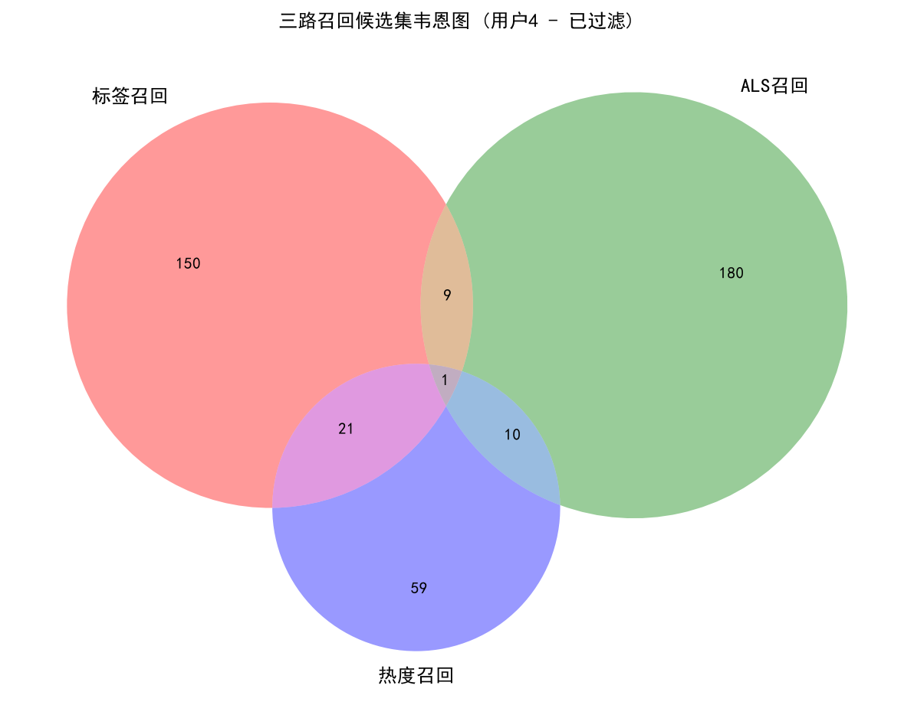

# 基于协同过滤的音乐推荐系统


> 基于 Last.fm 2K 数据集的音乐艺术家推荐：**多路召回（标签内容 / ALS 协同过滤 / 热度兜底） + LightGBM LambdaRank 精排**，并附带一个可交互的 Flask 网页 Demo。

*English: A music artist recommender built on the Last.fm HetRec 2011 dataset — multi-channel recall (tag content / ALS collaborative filtering / popularity) followed by a LightGBM LambdaRank reranker, plus an interactive Flask demo.*

---

## 一、效果预览

输入 `sad emotional piano`，网页 Demo 返回的结果：

| # | 艺术家 | 匹配度 | 标签 |
|---|---|---|---|
| 1 | Ludovico Einaudi | 68.4% | classical contemporary classical piano minimalist emotional |
| 2 | Max Richter | 51.4% | classical contemporary classical ambient minimalist cinematic |
| 3 | Phoebe Bridgers | 28.3% | indie folk singer-songwriter female sad emotional |

三路召回的候选集互补性（示例用户 4，已过滤历史交互）：



---

## 二、系统架构

```
                    ┌──────────────────────────────────────────┐
                    │            data/*.dat（Last.fm 2K）       │
                    └───────────────────┬──────────────────────┘
                                        │ preprocess.py
                         清洗冷启动 + 构建稀疏矩阵 + 8:1:1 划分
                                        │
              ┌─────────────────────────┼─────────────────────────┐
              │ 召回 A：标签 Jaccard      │ 召回 B：ALS 协同过滤      │ 召回 C：热度兜底
              │ （用户 Top-20 标签）      │ （隐向量 50 维）          │ （播放量 Top-200）
              └─────────────────────────┼─────────────────────────┘
                                        │ 合并去重（recall.py）
                                        ▼
                       ┌────────────────────────────────┐
                       │   精排：LightGBM LambdaRank     │  train_ranker.py
                       │   7 维特征 → NDCG@K 评估        │
                       └────────────────────────────────┘
                                        │
                                        ▼
                    ┌──────────────────────────────────────┐
                    │ Flask Demo（app.py + music.html）     │
                    │ 标签 → 艺术家，TF-IDF 余弦相似度检索    │
                    └──────────────────────────────────────┘
```

> 说明：网页 Demo 使用的是 `recommender.py` 内置的 45 位艺术家标签库做 TF-IDF 相似度检索，**用于展示交互效果**；召回 + 精排的完整推荐流水线在离线脚本中（`preprocess.py → recall.py → train_ranker.py`）。

---

## 三、目录结构

```
music-recommender/
├── app.py                 # Flask 网页 Demo：/ 、/recommend 、/api/recommend 、/health
├── recommender.py         # 标签检索推荐器（TF-IDF + 余弦相似度 + 同义词扩展）
├── preprocess.py          # 数据清洗、用户/艺术家映射、稀疏交互矩阵、8:1:1 划分
├── recall.py              # 多路召回（标签 / ALS / 热度）+ 召回统计 + 韦恩图
├── train_ranker.py        # LightGBM LambdaRank 排序模型 + NDCG 评估
├── templates/
│   └── music.html         # 前端页面（单文件：样式 + 交互 + 结果渲染）
├── data/                  # Last.fm HetRec 2011 原始数据集
│   ├── user_artists.dat
│   ├── user_taggedartists.dat
│   ├── user_taggedartists-timestamps.dat
│   ├── user_friends.dat
│   ├── artists.dat
│   ├── tags.dat
│   └── readme.txt         # 数据集官方说明
├── models/                # 预处理 / 训练产物（不入库，运行脚本后生成）
├── docs/venn3.png         # 召回效果图
├── outputs/               # recall.py 生成的图（不入库）
├── requirements.txt
└── README.md
```

---

## 四、快速开始

### 1. 环境

```bash
pip install -r requirements.txt
```

Python 3.10+；依赖：Flask、pandas、numpy、scipy、scikit-learn、implicit、LightGBM、matplotlib、matplotlib-venn。

### 2. 运行离线推荐流水线

```bash
python preprocess.py     # → models/preprocessed_data.pkl
python recall.py         # 训练 ALS 并输出召回统计 / outputs/venn3.png
python train_ranker.py   # → models/ranker_model.txt、NDCG 指标、特征重要性
```

### 3. 启动网页 Demo

```bash
python app.py
# 打开 http://127.0.0.1:5000
```

### 4. 调用 API

```bash
# GET（RESTful，便于外部集成）
curl "http://127.0.0.1:5000/api/recommend?tags=chill+electronic+ambient&top_n=5"

# POST（网页前端使用）
curl -X POST -d "tags=sad emotional piano" http://127.0.0.1:5000/recommend
```

| 接口 | 方法 | 参数 | 说明 |
|---|---|---|---|
| `/` | GET | — | 推荐页面 |
| `/recommend` | POST | `tags` | 网页表单接口，返回 Top-10 |
| `/api/recommend` | GET | `tags`、`top_n` | RESTful 接口 |
| `/health` | GET | — | 健康检查 |

返回示例：

```json
{
  "success": true,
  "query": "sad emotional piano",
  "count": 10,
  "results": [
    {"rank": 1, "artist": "Ludovico Einaudi", "score": 68.4,
     "tags": "classical contemporary classical piano minimalist emotional"}
  ]
}
```

---

## 五、实现细节

### 1. 数据预处理（`preprocess.py`）

- 过滤冷启动：用户收听记录 ≥ 10、艺术家被收听 ≥ 5
- 用户-艺术家稀疏交互矩阵（`csr_matrix`）
- 每个用户按 **8 : 1 : 1** 随机划分训练 / 验证 / 测试
- 从标签数据中抽取用户、艺术家各自的 Top-20 标签

| 指标 | 数值 |
|---|---|
| 原始记录 | 92,834 条（1,892 用户 / 17,632 艺术家） |
| 清洗后 | 1,871 用户 / 2,828 艺术家 |
| 交互矩阵 | 1,871 × 2,828，稀疏度 1.35% |
| 训练 / 验证 / 测试 | 56,382 / 7,094 / 7,909 |

### 2. 多路召回（`recall.py`）

| 通路 | 策略 | 候选数 |
|---|---|---|
| A 标签内容召回 | 用户 Top-20 标签与艺术家 Top-20 标签的 Jaccard 相似度排序 | 200 |
| B ALS 协同过滤 | `implicit.ALS(factors=50, regularization=0.1, iterations=30)`，已交互物品过滤 | 200 |
| C 热度兜底 | 训练集播放量 Top-200 中的 Top-100 | 100 |

三路合并去重后约 430 个候选（示例用户）。韦恩图显示三路交集仅 1 个，说明三类信号高度互补，多路召回能显著扩大候选覆盖面。

### 3. 排序模型（`train_ranker.py`）

- 样本：每个正样本随机采样 3 个负样本 → 225,528 条训练样本（正样本 56,382）
- 模型：`objective=lambdarank`、`metric=ndcg`、`num_leaves=64`、`learning_rate=0.05`，200 轮 + 20 轮早停

特征工程（7 维）：

| 特征 | 含义 |
|---|---|
| `user_total_plays` | 用户总播放量（活跃度） |
| `artist_popularity_log` | 艺术家全局热度（对数） |
| `tag_jaccard` | 用户-艺术家标签 Jaccard 相似度 |
| `user_active_bucket` | 用户活跃度分桶（5 档） |
| `artist_user_count_log` | 艺术家被多少不同用户听过（对数） |
| `user_artist_weight` | 用户对该艺术家的历史播放权重 |
| `artist_popularity_percentile` | 艺术家热度百分位 |

---

## 六、实验结果

| 指标 | 数值 |
|---|---|
| 验证集最佳迭代 | 第 2 轮（early stopping） |
| 验证集 NDCG@10 | 0.7163 |
| 测试集 NDCG@10 | **0.7211** |
| 测试集 NDCG@20 | **0.7424** |

特征重要性（gain）：

| 特征 | 重要性 |
|---|---|
| `user_artist_weight` | 42,121 |
| `user_total_plays` | ≈ 0 |
| `artist_popularity_log` | ≈ 0 |
| 其余特征 | ≈ 0 |

> ⚠️ **结果说明（已知问题）**：当前评估口径是「正样本 1 : 随机负样本 3」的 pairwise 采样，而非在真实召回候选集上做全量排序；同时 `user_artist_weight` 在训练集中只对正样本非零，模型因此退化成「是否交互过」的判别器，早停在第 2 轮，测试时该特征恒为 0，泛化能力有限。上表指标用于验证链路可跑通，**不应视为该推荐系统的真实线上效果**。改进方向见「后续计划」。

---

## 七、后续计划

- [ ] 用 `recall.py` 产出的候选集构造「全量排序」评估集，改用标准 NDCG@K（而非 1:3 负采样）评估
- [ ] 移除 `user_artist_weight` 等训练/推理分布不一致的泄漏特征，重新调参
- [ ] 把离线召回 + 精排接入 Web：按用户 ID/历史行为推荐，而不只按标签检索
- [ ] 接入 Last.fm API 补充艺术家头像与试听，丰富页面展示
- [ ] 提供 Docker 镜像与一键运行脚本

---

## 八、数据集

[hetrec2011-lastfm-2k](http://ir.ii.uam.es/hetrec2011/datasets.html)（HetRec 2011 Workshop @ RecSys 2011），包含 1,892 位 Last.fm 用户的社交、打标签与收听行为：

- 17,632 位艺术家，92,834 条 `[user, artist, listeningCount]` 记录
- 11,946 个标签，186,479 条 `[user, tag, artist]` 标注
- 12,717 对双向好友关系

数据集仅用于学术研究，版权归原作者所有，详见 `data/readme.txt`。

---

## 九、作者

孙一鸣 · 学号 3123080127

如果这个项目对你有帮助，欢迎 Star ⭐
